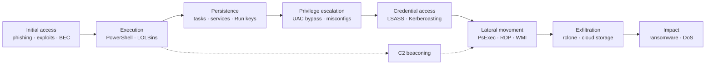

# SOC Attack Handbook

**The attacks a SOC analyst needs to know: how they work, what they look like in logs, how to detect them and how to respond.**

[Stuck on an alert?](reference/symptom-lookup.md) · [Attack lifecycle](basics/attack-lifecycle.md) · [Windows event IDs](reference/windows-event-ids.md) · [Sysmon](reference/sysmon-event-ids.md) · [Key terms](basics/key-terms.md)

---

> [!TIP]
> **Looking at an alert and not sure what it is?** Start at **[I see X, what is it?](reference/symptom-lookup.md)**. Find what's in the log, and it points you to the attack page that explains it.

## How an intrusion unfolds

Every section of this handbook maps to a stage of a real attack. When you see one stage, ask: **what came before, and what comes next?**

## How every attack page is laid out

| Section | What it gives you |
|---|---|
| **In one line** | The attack in a single sentence |
| **Quick facts** | MITRE ATT&CK ID, tactic, common targets and tools |
| **How it works** | The attacker's steps, in order |
| **What you see in logs** | Event IDs, log lines and network signs, by log source |
| **How to detect it** | The pattern to look for, with an example Splunk search |
| **How to respond** | What to check first, how to contain it, how to fix the cause |
| **Don't confuse with** | Similar attacks and how to tell them apart |

## Contents

### [Initial access](initial-access/README.md)

| Attack | ATT&CK / ID | In one line |
|---|---|---|
| [Phishing](initial-access/phishing.md) | T1566 | A fake message tricks the user into clicking a link, opening an attachment or entering their password. |
| [Business email compromise (BEC)](initial-access/business-email-compromise.md) | T1534, T1114.003 | The attacker pretends to be (or takes over) a trusted email account, an executive, a vendor or a lawyer, and asks someone to send money or sensitive data. |
| [Social engineering](initial-access/social-engineering.md) | T1566.004, T1219 | Manipulating people instead of computers: phone calls, SMS, fake IT support and help desk tricks to get passwords, MFA codes or remote access. |
| [Drive-by compromise](initial-access/drive-by-compromise.md) | T1189 | The user visits a website (hacked, fake or malicious ad) and gets infected, either by an exploit or by being tricked into downloading a "fake update" or "fake installer". |
| [Exploiting public-facing applications](initial-access/exploit-public-facing-app.md) | T1190 | The attacker hacks an internet-facing system (web app, VPN, firewall, mail server, file transfer server) using a vulnerability, and gets code running on it. |
| [Supply chain attack](initial-access/supply-chain.md) | T1195, T1199 | The attacker compromises software, an update or a provider you already trust, so the malware arrives through a trusted channel. |

### [Credential attacks](credential-attacks/README.md)

| Attack | ATT&CK / ID | In one line |
|---|---|---|
| [Brute force](credential-attacks/brute-force.md) | T1110.001 | The attacker tries many passwords against one account until one works. |
| [Password spraying](credential-attacks/password-spraying.md) | T1110.003 | The attacker tries one common password against many accounts, slowly, so no single account gets locked out. |
| [Credential stuffing](credential-attacks/credential-stuffing.md) | T1110.004 | The attacker takes username + password pairs leaked from other websites and tries them on your login page, betting that people reuse passwords. |
| [MFA fatigue (push bombing)](credential-attacks/mfa-fatigue.md) | T1621 | The attacker already has the password and sends MFA push notifications over and over until the user taps "Approve" to make them stop. |
| [Credential dumping](credential-attacks/credential-dumping.md) | T1003 | The attacker, with admin rights on a machine, pulls passwords and hashes out of Windows (memory, registry or the AD database) to use on other machines. |
| [DCSync](credential-attacks/dcsync.md) | T1003.006 | The attacker pretends to be a domain controller and asks a real DC to send over everyone's password hashes using normal AD replication. |
| [Pass-the-hash](credential-attacks/pass-the-hash.md) | T1550.002 | The attacker logs in with a stolen NTLM password hash instead of the password. No cracking needed. |
| [Pass-the-ticket](credential-attacks/pass-the-ticket.md) | T1550.003 | The attacker steals a Kerberos ticket from memory on one machine and loads it into their own session to act as that user. |
| [Kerberoasting](credential-attacks/kerberoasting.md) | T1558.003 | Any domain user requests service tickets for service accounts, takes them offline, and cracks the service account's password from the ticket. |
| [AS-REP roasting](credential-attacks/as-rep-roasting.md) | T1558.004 | For accounts with Kerberos pre-authentication disabled, anyone can ask the DC for a TGT response and crack the user's password from it offline. |
| [Golden and silver ticket](credential-attacks/golden-silver-ticket.md) | T1558.001, T1558.002 | With a stolen Kerberos key, the attacker forges their own tickets: a golden ticket (forged TGT) gives access to the whole domain; a silver ticket (forged service ticket) gives access to one service. |

### [Malware](malware/README.md)

| Attack | ATT&CK / ID | In one line |
|---|---|---|
| [Ransomware](malware/ransomware.md) | T1486, T1490 | The attacker encrypts the organisation's files and systems and demands payment for the decryption key. Most groups steal the data first and threaten to publish it (double extortion). |
| [Trojans and RATs](malware/trojans-and-rats.md) | T1204.002, T1071 | A trojan pretends to be legitimate software. A RAT (Remote Access Trojan) is a trojan that gives the attacker full remote control of the machine. |
| [Worms](malware/worms.md) | T1210, T1091 | Malware that spreads from machine to machine by itself, without anyone clicking anything, by exploiting a vulnerability or using stolen credentials. |
| [Infostealers](malware/infostealers.md) | T1555.003, T1539 | Malware that quickly steals saved passwords, browser cookies, crypto wallets and files, sends them to the attacker, and often deletes itself. |
| [Fileless malware](malware/fileless-malware.md) | T1059.001, T1620 | Malicious code that runs in memory and uses built-in Windows tools, leaving little or no malicious file on disk for antivirus to scan. |
| [PowerShell abuse](malware/powershell-abuse.md) | T1059.001 | Attackers use PowerShell, Windows' built-in scripting language, to download, decode and run malicious code while blending in with admin activity. |
| [LOLBins (Living off the Land)](malware/lolbins.md) | T1218, T1105 | Attackers use legitimate, Microsoft-signed programs already on Windows to download files, run code and bypass security, so nothing "foreign" is installed. |

### [Web attacks](web-attacks/README.md)

| Attack | ATT&CK / ID | In one line |
|---|---|---|
| [SQL injection (SQLi)](web-attacks/sql-injection.md) | T1190 | The attacker puts SQL code into an input field so the database runs it, letting them read, change or delete data, or bypass login. |
| [Cross-site scripting (XSS)](web-attacks/xss.md) | T1189, T1539 | The attacker gets their JavaScript to run in other users' browsers on a trusted website, to steal sessions, capture input or act as the user. |
| [Command injection](web-attacks/command-injection.md) | T1190, T1059 | The application passes user input to an operating system shell, and the attacker adds their own commands, getting code execution on the server. |
| [Path traversal and file inclusion (LFI / RFI)](web-attacks/path-traversal.md) | T1190 | The attacker uses `../` in a file name parameter to read files outside the web folder (path traversal), or makes the application load and run a local or remote file (file inclusion). |
| [Server-side request forgery (SSRF)](web-attacks/ssrf.md) | T1190, T1552.005 | The attacker makes the server send a request to a URL they choose, usually an internal system the attacker can't reach directly, like the cloud metadata service. |
| [Cross-site request forgery (CSRF)](web-attacks/csrf.md) | CWE-352 | A malicious website makes the victim's browser send a request to another site where the victim is logged in, so the action runs with the victim's session (change email, transfer money). |
| [Insecure direct object reference (IDOR)](web-attacks/idor.md) | CWE-639 | The attacker changes an ID in a request (`invoice=1001` → `1002`) and gets someone else's data, because the server never checks that the object belongs to them. |
| [File upload attacks and web shells](web-attacks/file-upload-web-shell.md) | T1505.003 | The attacker uploads a script (`.php`, `.aspx`, `.jsp`) to the web server and then opens it in the browser, giving them a web shell: a web page that runs any command on the server. |

### [Network attacks](network-attacks/README.md)

| Attack | ATT&CK / ID | In one line |
|---|---|---|
| [Reconnaissance and scanning](network-attacks/reconnaissance-scanning.md) | T1595, T1046 | Before attacking, the attacker collects information: which hosts are alive, which ports are open, which software and versions are running, who works there. |
| [DoS and DDoS](network-attacks/dos-ddos.md) | T1498, T1499 | The attacker overloads a service (bandwidth, server resources or the application) so real users can't use it. DDoS = from many machines at once (a botnet). |
| [Man-in-the-middle (MITM) and ARP spoofing](network-attacks/mitm-arp-spoofing.md) | T1557.002 | The attacker places themselves between the victim and the network so all traffic passes through them, letting them read or change it. |
| [LLMNR / NBT-NS poisoning](network-attacks/llmnr-nbtns-poisoning.md) | T1557.001 | When a Windows machine can't resolve a name through DNS, it asks the whole local network. The attacker answers "that's me", and the victim sends them its NTLM password hash. |
| [DNS tunneling](network-attacks/dns-tunneling.md) | T1071.004, T1048 | The attacker hides commands and stolen data inside DNS queries and answers, because almost every network allows DNS out. |
| [C2 beaconing](network-attacks/c2-beaconing.md) | T1071, T1573 | Malware on an infected machine regularly contacts the attacker's command-and-control (C2) server to ask "any new commands?". These regular check-ins are called beacons. |

### [Post-exploitation](post-exploitation/README.md)

| Attack | ATT&CK / ID | In one line |
|---|---|---|
| [Privilege escalation](post-exploitation/privilege-escalation.md) | TA0004 | The attacker turns limited access into higher access: normal user → local admin → SYSTEM / root → Domain Admin. |
| [Persistence](post-exploitation/persistence.md) | TA0003 | The attacker sets something up so they keep access after a reboot, a password change or a removed malware file. |
| [Lateral movement](post-exploitation/lateral-movement.md) | TA0008 | The attacker moves from the first compromised machine to other machines, using stolen credentials and normal admin tools, until they reach what they want (domain controller, file servers, backups). |
| [Defense evasion](post-exploitation/defense-evasion.md) | TA0005 | The attacker avoids being detected: disables security tools, clears logs, disguises malware as legitimate files and hides activity in trusted processes. |
| [Data exfiltration](post-exploitation/data-exfiltration.md) | TA0010 | The attacker copies data out of the organisation to a place they control, usually to sell it or to threaten to publish it (ransomware double extortion). |

### [Cloud and identity](cloud-identity/README.md)

| Attack | ATT&CK / ID | In one line |
|---|---|---|
| [Session token theft (AiTM phishing)](cloud-identity/session-token-theft.md) | T1557, T1539 | A phishing site sits between the user and the real login page, lets the user log in normally including MFA, and steals the session cookie that comes back. The attacker uses that cookie to be logged in as the user, with no password or MFA needed. |
| [OAuth consent phishing](cloud-identity/oauth-consent-phishing.md) | T1528, T1550.001 | The attacker tricks a user into clicking "Accept" on a real Microsoft/Google permissions screen, giving the attacker's app access to the user's mail and files. The access keeps working even after a password reset or MFA. |
| [Cloud misconfiguration and key abuse](cloud-identity/cloud-misconfiguration.md) | T1530, T1552.001 | Many cloud breaches need no exploit: data is left public, access keys are leaked, or permissions are far too wide. Attackers scan for these constantly. |

### [Insider threat](insider-threat/README.md)

Harm caused by someone with legitimate access: an employee, contractor or partner who misuses it on purpose, by accident, or because their account was taken over.

## Quick reference

| Page | Use it when |
|---|---|
| [I see X, what is it?](reference/symptom-lookup.md) | You have an alert or log line and need to name the attack |
| [Windows event IDs](reference/windows-event-ids.md) | You need to know what 4624, 4769, 7045 or 1102 means, plus logon types and failure codes |
| [Sysmon event IDs](reference/sysmon-event-ids.md) | You're reading Sysmon data and need the most useful patterns |
| [Linux logs](reference/linux-logs.md) | You need to know which file holds SSH, sudo or cron activity, and where persistence hides |
| [Log sources](reference/log-sources.md) | You need to know which log answers your question |
| [Common ports](reference/common-ports.md) | You see a port and want to know what normally runs there |

## Basics

- [Attack lifecycle](basics/attack-lifecycle.md): Cyber Kill Chain, the 14 MITRE ATT&CK tactics, Pyramid of Pain
- [Key SOC terms](basics/key-terms.md): IOC vs IOA, TP / FP / FN, SIEM / EDR / SOAR, NIST incident response phases

---

> [!NOTE]
> **About the Splunk searches.** They use common field names (`src_ip`, `user`, `dest`). Your environment may name them differently depending on the add-on that parses the logs, for example `IpAddress` or `Account_Name` for raw Windows events. Treat them as patterns to adapt, not copy-paste rules.
