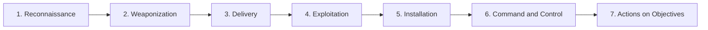

# Attack lifecycle

Attacks happen in stages. Knowing the stage tells you **what the attacker already has** and **what they will try next**. Two models are used everywhere: the Cyber Kill Chain and MITRE ATT&CK.

## Cyber Kill Chain (Lockheed Martin)

Seven stages, from first research to the final goal.

| Stage | What the attacker does | Example |
|---|---|---|
| 1. Reconnaissance | Collects information about the target | Scans ports, reads LinkedIn for employee names |
| 2. Weaponization | Builds the attack payload | Puts a macro in a Word file |
| 3. Delivery | Sends the payload to the target | Phishing email with the Word file |
| 4. Exploitation | The payload runs | User enables macros, the macro runs code |
| 5. Installation | Installs malware that stays | Drops a RAT, adds a registry Run key |
| 6. Command and Control (C2) | Malware connects back to the attacker | HTTPS beacon to the attacker's server every 60 seconds |
| 7. Actions on Objectives | Does what they came for | Steals data, encrypts files |

**Why it matters:** the earlier you stop an attack in the chain, the less damage. Stopping delivery (blocking the email) is better than responding after actions on objectives (data already gone).

## MITRE ATT&CK

ATT&CK is a large catalogue of real attacker behaviour. It has three levels:

- **Tactic**: the attacker's goal at that moment ("why"). Example: Credential Access.
- **Technique**: how they reach that goal ("how"). Example: T1110 Brute Force.
- **Sub-technique**: a more specific version. Example: T1110.003 Password Spraying.

### The 14 Enterprise tactics, in order

| # | Tactic | The attacker is trying to... | Pages in this handbook |
|---|---|---|---|
| 1 | Reconnaissance | gather information | [Scanning](../network-attacks/reconnaissance-scanning.md) |
| 2 | Resource Development | set up infrastructure (domains, servers, accounts) | |
| 3 | Initial Access | get into the network | [Initial access](../initial-access/index.md) |
| 4 | Execution | run their code | [PowerShell](../malware/powershell-abuse.md), [LOLBins](../malware/lolbins.md) |
| 5 | Persistence | keep access after reboots or password changes | [Persistence](../post-exploitation/persistence.md) |
| 6 | Privilege Escalation | get higher permissions | [Privilege escalation](../post-exploitation/privilege-escalation.md) |
| 7 | Defense Evasion | avoid being detected | [Defense evasion](../post-exploitation/defense-evasion.md) |
| 8 | Credential Access | steal usernames, passwords, hashes, tickets | [Credential attacks](../credential-attacks/index.md) |
| 9 | Discovery | learn about the internal environment | `whoami`, `net group "domain admins"`, AD enumeration |
| 10 | Lateral Movement | move to other machines | [Lateral movement](../post-exploitation/lateral-movement.md) |
| 11 | Collection | gather the data they want | Archive files with 7-Zip / WinRAR |
| 12 | Command and Control | talk to compromised machines | [C2 beaconing](../network-attacks/c2-beaconing.md) |
| 13 | Exfiltration | steal the data out | [Data exfiltration](../post-exploitation/data-exfiltration.md) |
| 14 | Impact | damage, encrypt or disrupt | [Ransomware](../malware/ransomware.md), [DoS](../network-attacks/dos-ddos.md) |

## How a real intrusion moves through these stages

A typical ransomware intrusion, step by step:

1. **Initial access:** a user opens a phishing attachment.
2. **Execution:** the attachment runs PowerShell, which downloads a loader.
3. **Persistence:** the loader creates a scheduled task.
4. **C2:** the loader beacons to the attacker's server.
5. **Discovery:** the attacker runs `net group "domain admins" /domain`.
6. **Credential access:** they dump LSASS and get an admin's hash.
7. **Lateral movement:** they use the hash to log in to other servers (pass-the-hash).
8. **Exfiltration:** they upload files to cloud storage.
9. **Impact:** they deploy ransomware to every server and delete backups.

As a SOC analyst, when you see one stage, ask: **what came before this, and what comes next?** Then search for both.

## Pyramid of Pain

How much it "hurts" the attacker when you detect and block each kind of indicator:

| Level (bottom = easiest for attacker to change) | Example |
|---|---|
| Hash values | SHA256 of a malware file. Changing one byte gives a new hash |
| IP addresses | C2 server IP. Attacker can move to a new IP in minutes |
| Domain names | `evil-update[.]com`. New domains are cheap |
| Network / host artifacts | A specific User-Agent string, a specific registry key |
| Tools | Mimikatz, Cobalt Strike. Replacing a tool takes real effort |
| **TTPs** (top = hardest to change) | "Dumps LSASS memory", "moves laterally with PsExec". Behaviour is very hard to change |

**Detections based on behaviour (TTPs) last longer than detections based on hashes and IPs.**
