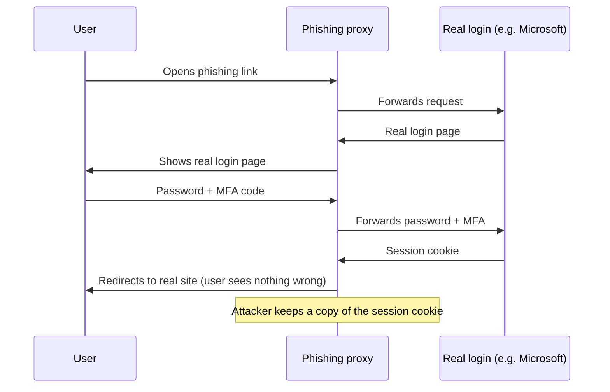

# Session token theft (AiTM phishing)

!!! abstract "In one line"
    A phishing site **sits between the user and the real login page**, lets the user log in normally **including MFA**, and steals the **session cookie** that comes back. The attacker uses that cookie to be logged in as the user, with no password or MFA needed.

| | |
|---|---|
| **MITRE ATT&CK** | [T1557 Adversary-in-the-Middle](https://attack.mitre.org/techniques/T1557/), [T1539 Steal Web Session Cookie](https://attack.mitre.org/techniques/T1539/), [T1550.004 Use Alternate Authentication Material: Web Session Cookie](https://attack.mitre.org/techniques/T1550/004/) |
| **Tactics** | Credential Access, Defense Evasion, Lateral Movement |
| **Common kits** | Evilginx, EvilProxy, Tycoon 2FA, sold as Phishing-as-a-Service |
| **Bypasses** | Passwords + SMS codes, authenticator app codes and push MFA |

## How it works

1. The user clicks a phishing link (email, QR code, Teams message).
2. The page **is** the real Microsoft/Google login, relayed through the attacker's server, so it looks perfect.
3. The user enters password and completes MFA.
4. The identity provider issues a **session cookie**. The proxy copies it.
5. The attacker imports the cookie into their browser and is logged in.
6. Next steps are usually: read email, create inbox rules, [BEC](../initial-access/business-email-compromise.md) fraud, register a new MFA method, consent an OAuth app.

[Infostealers](../malware/infostealers.md) steal session cookies too, from the browser on the user's machine.

## What you see in logs

| Log source | What to look for |
|---|---|
| Entra ID sign-in logs | Successful sign-in with MFA **from the proxy's IP** (often a hosting provider), then the **same session** used from a **different IP / country / device / browser** shortly after |
| Entra ID Protection | Risk detections: **Anomalous token**, **Attacker in the Middle**, **Unfamiliar sign-in properties**, **Impossible travel** |
| Entra ID audit logs | New MFA method registered; new inbox rules; new OAuth app consent |
| Proxy / DNS | User visited a **lookalike or newly registered domain** right before the suspicious sign-in |
| Email gateway | The phishing email (often with a QR code or a link through a legitimate redirect service) |

## How to detect it

- Same user, two very different locations or devices within minutes, where the first sign-in passed MFA.
- Sign-ins with MFA satisfied from **datacenter / VPS IPs**.
- Session used from an IP that **never performed** the interactive login.

## How to respond

1. **Revoke all sessions / refresh tokens** for the user (e.g. "Revoke sessions" in Entra ID). **Resetting the password alone doesn't kill a stolen session.**
2. Reset the password (the attacker saw it too).
3. Remove attacker-added **MFA methods, inbox rules, forwarding, OAuth apps**.
4. Review what the attacker accessed: mail read and sent, files downloaded.
5. Find and block the **phishing domain**; find **other users** who visited it.
6. **Fix:** **phishing-resistant MFA** (FIDO2 security keys, passkeys, Windows Hello for Business). These check the real website's domain, so a proxy can't relay them. Conditional Access requiring **managed/compliant devices**, token protection, short session lifetimes.

## References

- [MITRE ATT&CK T1557](https://attack.mitre.org/techniques/T1557/)
- [MITRE ATT&CK T1550.004](https://attack.mitre.org/techniques/T1550/004/)
