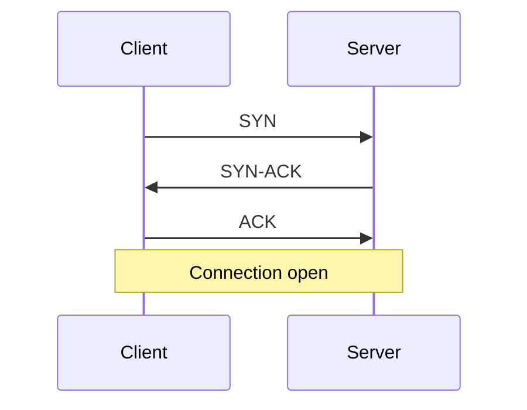

# Network attacks

Attacks that abuse **network protocols**: finding targets, overloading services, intercepting traffic, and hiding communication.

| Attack | What it abuses | MITRE |
|---|---|---|
| [Reconnaissance and scanning](reconnaissance-scanning.md) | Probing to find hosts, ports and services | T1595, T1046 |
| [DoS and DDoS](dos-ddos.md) | Flooding a service until it stops working | T1498, T1499 |
| [MITM and ARP spoofing](mitm-arp-spoofing.md) | ARP has no authentication, so traffic can be redirected | T1557.002 |
| [LLMNR / NBT-NS poisoning](llmnr-nbtns-poisoning.md) | Windows fallback name resolution trusts anyone who answers | T1557.001 |
| [DNS tunneling](dns-tunneling.md) | Hiding data and commands inside DNS queries | T1071.004 |
| [C2 beaconing](c2-beaconing.md) | Malware regularly "checking in" with the attacker | T1071, T1573 |

## Where each attack sits (OSI layers)

| Layer | Name | Example attacks |
|---|---|---|
| 7 | Application | HTTP flood, DNS tunneling, C2 over HTTPS, [web attacks](../web-attacks/index.md) |
| 4 | Transport | SYN flood, port scanning |
| 3 | Network | IP spoofing, ICMP flood, routing attacks |
| 2 | Data link | ARP spoofing, MAC flooding, VLAN hopping |

## TCP handshake (needed for scanning and SYN floods)

| Server's reply to a SYN | Meaning |
|---|---|
| **SYN-ACK** | Port is **open** |
| **RST** | Port is **closed** |
| Nothing, or ICMP unreachable | Port is **filtered** (firewall) |

**TCP flags:** `SYN` start, `ACK` acknowledge, `FIN` finish, `RST` reset/abort, `PSH` push data, `URG` urgent.

## Zeek `conn.log` connection states you'll meet

| `conn_state` | Meaning | Often seen in |
|---|---|---|
| `S0` | SYN sent, no reply | Scans to filtered ports, SYN floods |
| `REJ` | SYN answered with RST | Scans to closed ports |
| `SF` | Normal open and close | Normal traffic |
| `RSTO` / `RSTR` | Connection reset by originator / responder | SYN scans (client sends RST after SYN-ACK) |
